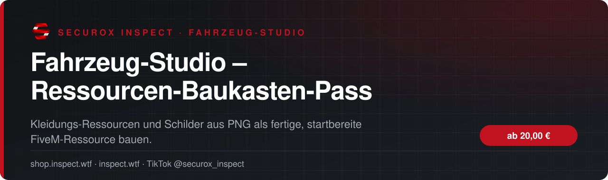
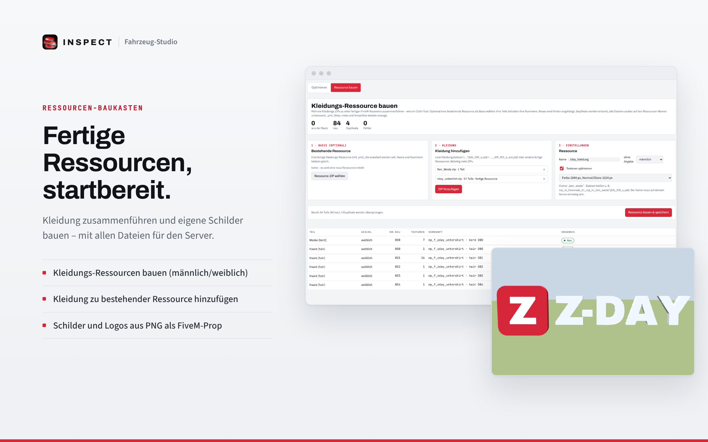

<!-- inspect-showcase: automatisch erzeugt, Änderungen bitte im Shop vornehmen -->

  
  
  
  

  
  
  

 

> 🇬🇧 **English:** Fahrzeug-Studio – Ressourcen-Baukasten-Pass – browser-based FiveM vehicle editor for .ytd/.yft files – textures, 3D models and optimisation by SecuroX Inspect. Purchase and licensing exclusively at [shop.inspect.wtf](https://shop.inspect.wtf). Product details below are in German – questions are welcome on [Discord](https://discord.gg/inspect).

 

## Das Wichtigste auf einen Blick

<table>
  <tr>
    <td width="50%" valign="top">✔&nbsp; <b>Kleidungs-Ressourcen bauen (männlich/weiblich)</b></td>
    <td width="50%" valign="top">✔&nbsp; <b>Kleidung zu bestehender Ressource hinzufügen</b></td>
  </tr>
  <tr>
    <td width="50%" valign="top">✔&nbsp; <b>Schilder und Logos aus PNG als FiveM-Prop – z. B. eigener Servername statt der Vinewood-Buchstaben</b></td>
    <td width="50%" valign="top">✔&nbsp; <b>Leuchtend, auf der Karte platziert (.ymap)</b></td>
  </tr>
</table>

## Überblick

Der Ressourcen-Baukasten-Pass schaltet die Ressourcen-Bereiche des INSPECT Fahrzeug-Studios frei – für beliebig viele Dateien während der Laufzeit.

Kleidung: Aus Kleidungs-ZIPs eine fertige Kleidungs-Ressource für männlich oder weiblich bauen oder neue Kleidung zu einer bestehenden Ressource hinzufügen – Texturen auf Wunsch gleich mit optimiert.

Schild: Aus einem PNG mit Schriftzug oder Logo ein fertiges FiveM-Prop erzeugen – ausgeschnitten oder als Tafel, einfarbig oder mit Bild, auf Wunsch nachts oder dauerhaft leuchtend und direkt auf der Karte platziert (.ymap).

Beliebt: dein eigenes Vinewood-Schild. PNG mit deinem Servernamen laden – das Studio baut daraus 3D-Buchstaben mit Kollision und ersetzt damit die Vinewood-Buchstaben am Hügel, die Position ist schon voreingestellt.

## Kompatibilität

| | |
|:--|:--|
| Plattform | FiveM (GTA V) |

## Alle weiteren Funktionen

- Beliebig viele Dateien während der Laufzeit
- Bearbeitete Dateien 7 Tage im Kundenkonto abrufbar
- Originaldateien bleiben auf deinem Rechner
- Läuft im Browser – ohne Blender, ohne OpenIV, ohne Installation

## Laufzeiten & Preise

| Laufzeit | Preis |
|:--|--:|
| 1 Tag | **20,00 €** |
| 7 Tage | **42,99 €** |
| 30 Tage | **59,99 €** |

Sichere Zahlung mit PayPal oder Kreditkarte · Rechnung als PDF · Support auf Deutsch

## So einfach geht's

1. **Im Shop kaufen** – sicher bezahlen mit PayPal oder Kreditkarte.
2. **Sofort loslegen** – Download und Lizenz stehen direkt nach Zahlungseingang in deinem Kundenkonto bereit, die Rechnung erhältst du als PDF.
3. **Einrichten** – bei Fragen hilft dir unser Support im Discord weiter.

## Warum INSPECT?

<table>
  <tr>
    <td width="50%" valign="top"><b>🇩🇪 Entwickelt in Deutschland</b> Konzeption, Entwicklung und Support aus einer Hand.</td>
    <td width="50%" valign="top"><b>💬 Persönlicher Support</b> Schnelle Hilfe auf Deutsch im INSPECT Discord.</td>
  </tr>
  <tr>
    <td width="50%" valign="top"><b>🔒 Sichere Zahlung</b> PayPal oder Kreditkarte, Rechnung automatisch als PDF.</td>
    <td width="50%" valign="top"><b>⚡ Sofort verfügbar</b> Download und Lizenz direkt nach der Zahlung im Kundenkonto.</td>
  </tr>
</table>

## Häufige Fragen

<b>Wie erhalte ich das Produkt?</b>

 

Nach bestätigter Zahlung stehen Download und Lizenz in deinem Kundenkonto bereit. Die Rechnung erhältst du als PDF.

<b>Wie funktionieren die Laufzeiten?</b>

 

Du wählst beim Kauf die passende Laufzeit. Die Lizenz ist danach sofort aktiv und in deinem Kundenkonto einsehbar.

<b>Bekomme ich Hilfe bei der Einrichtung?</b>

 

Ja – unser Support hilft dir im [INSPECT Discord](https://discord.gg/inspect) persönlich und auf Deutsch.

<b>Wo kaufe ich offiziell?</b>

 

Ausschließlich im INSPECT Shop unter [shop.inspect.wtf](https://shop.inspect.wtf). Angebote von Dritten stammen nicht von uns.

## Kontakt

| | |
|:--|:--|
| 🛒 Shop | [shop.inspect.wtf](https://shop.inspect.wtf) |
| 🌐 Website | [inspect.wtf](https://inspect.wtf) |
| 💬 Discord | [discord.gg/inspect](https://discord.gg/inspect) |
| 🎬 TikTok | [@securox_inspect](https://www.tiktok.com/@securox_inspect) |
| ✉️ E-Mail | [info@inspect.wtf](mailto:info@inspect.wtf) |

---

<b>SecuroX Inspect</b> · Offizielle Produktpräsentation · Dieses Repository enthält keinen Quellcode und keine Produktdateien. 
Kauf und Lizenzen ausschließlich über <a href="https://shop.inspect.wtf">shop.inspect.wtf</a> · Inhalte werden automatisch aus dem Shop aktualisiert.

